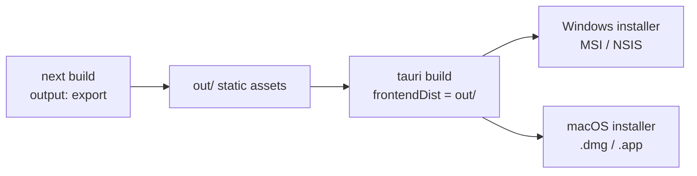
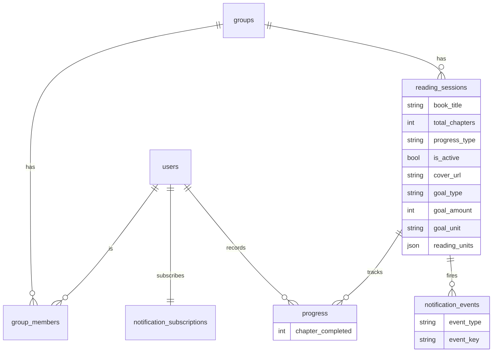
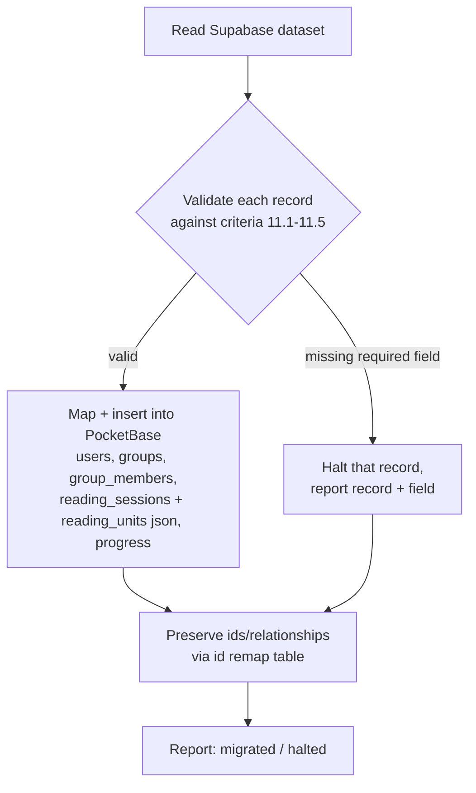

# Design Document

## Overview

Reading Sync is migrating from a browser-hosted Next.js 16 / React 19 web app backed by Supabase and OneSignal into a native desktop application for Windows and macOS. The migration has two intertwined tracks:

- **Runtime & backend migration (Requirements 1–11):** Package the existing React UI inside a [Tauri](https://tauri.app/) desktop shell, remove Supabase entirely, and replace it with a self-hosted [PocketBase](https://pocketbase.io/) backend that provides authentication, data storage, and realtime subscriptions. OneSignal web push is replaced by Tauri's native OS notification plugin, with the backend remaining the source of notification events.
- **UI redesign vertical slice (Requirements 12–15):** Establish the Warm Editorial Bento design tokens app-wide in a single shared stylesheet, then restyle only the Group Reading Room into the bento-grid layout, add a Navigation Rail with a Light/Dark/System theme toggle, and apply cross-platform titlebar safe areas.

The guiding constraints are: **reuse the existing React UI** (no screen reimplemented outside React), **preserve every existing user-facing behavior and data concept**, and **treat `.kiro/steering/ui-design.md` as the authoritative source** for all token values, typography, layout breakpoints, and titlebar dimensions.

The product remains a multi-user, realtime, collaborative reading tracker. The core design challenge is swapping the transport and persistence layer (Supabase → PocketBase) and the host environment (browser → Tauri) while keeping the React component tree and user-visible behavior intact, then layering a scoped visual redesign on top.

### Key design decisions and rationale

| Decision | Rationale |
| --- | --- |
| **Tauri over Electron** | Smaller installers, lower memory, native webview, first-class Rust plugins for notifications/secure storage, and native installer tooling (MSI/NSIS on Windows, `.dmg`/`.app` on macOS). Requirement 1 only needs a reused React UI in a native shell. |
| **Next.js static export (SPA) over App Router server runtime** | Tauri serves static assets from disk; there is no Node server at runtime. The app is exported as a client-rendered SPA. Server-only constructs (the `/api/notifications/progress` route, `proxy.ts` middleware, `manifest.ts` PWA manifest) are removed — their responsibilities move to PocketBase hooks and client-side guards. |
| **PocketBase SDK wrapped in a `Backend_Client` module** | A single seam isolates the rest of the app from PocketBase specifics, mirroring the old `createClient()` seam and making the transport layer swappable and testable. |
| **Notification events owned by the backend, delivered natively** | Requirement 8 keeps the backend as the source of truth for *when* an event fires (fire-once semantics) but moves *delivery* to the OS via Tauri. This preserves the existing "claim-once" idempotency model from `notification_events`. |
| **Global tokens, scoped redesign** | Requirement 13.9 explicitly limits visual restyling to the Group Reading Room. Tokens are global (Req 12) so later screens inherit them, but only one screen is rebuilt in this slice. |

### Requirements coverage map

| Area | Requirements |
| --- | --- |
| Overview / scope | Intro, 1.3 |
| Tauri packaging, installers, launch | 1 |
| Supabase removal | 2 |
| Auth (create/login/logout/session/guard) | 3 |
| Groups & membership | 4 |
| Reading sessions | 5 |
| Progress tracking | 6 |
| Realtime sync | 7 |
| Native notifications | 8 |
| Backend endpoint config | 9 |
| Offline behavior | 10 |
| Data model & migration | 11 |
| Design-token foundation | 12 |
| Group Reading Room redesign | 13 |
| Theme toggle | 14 |
| Titlebar safe areas | 15 |

---

## Architecture

### High-level layering

The application separates into four layers. The **Desktop Shell** (Rust/Tauri) owns the window, native capabilities, and installers. The **React UI** (unchanged component tree, reused per Req 1.3) renders all screens. A thin **client services layer** (`Backend_Client`, `Auth_Service`, `Sync_Engine`, `Notification_Service`, config store) mediates between React and the backend. The **PocketBase Backend** owns auth, data, realtime, and notification-event evaluation.

```mermaid
graph TD
    subgraph Desktop Shell (Tauri / Rust)
        WIN[Window + WebView]
        NOTIF[notification plugin]
        STORE[secure/persistent store plugin]
        OS[os plugin — platform detection]
        INST[Installer bundler: MSI/NSIS, dmg/app]
    end

    subgraph React UI (reused)
        SCREENS[Screens: login, create-account, dashboard,<br/>create-group, join-group, create-session, Group Reading Room]
        RAIL[Navigation Rail + Theme Toggle]
        TITLEBAR[Titlebar safe-area layout]
    end

    subgraph Client Services
        BC[Backend_Client<br/>wraps PocketBase SDK]
        AUTH[Auth_Service]
        SYNC[Sync_Engine]
        NS[Notification_Service]
        CFG[Config store<br/>Backend_Endpoint + Theme_Preference]
    end

    subgraph PocketBase Backend (self-hosted)
        PBAUTH[Auth / users]
        PBDATA[Collections: groups, group_members,<br/>reading_sessions, progress, notification_*]
        PBRT[Realtime subscriptions]
        PBHOOKS[Hooks: invite-code, progress clamp,<br/>notification event evaluation]
    end

    SCREENS --> BC
    RAIL --> CFG
    SCREENS --> AUTH
    SCREENS --> SYNC
    SCREENS --> NS
    AUTH --> BC
    SYNC --> BC
    NS --> BC
    NS --> NOTIF
    AUTH --> STORE
    CFG --> STORE
    TITLEBAR --> OS
    BC --> PBAUTH
    BC --> PBDATA
    SYNC --> PBRT
    PBDATA --> PBHOOKS
```

### Runtime adaptation: Next.js App Router → Tauri SPA

The current app uses the App Router with `"use client"` screens, a server middleware (`proxy.ts`), a server route (`app/api/notifications/progress/route.ts`), and a PWA `manifest.ts`. Under Tauri there is no Node server at runtime, so:

- **Static export.** `next.config.ts` sets `output: "export"` so `next build` emits a static `out/` directory of HTML/JS/CSS. Tauri's `frontendDist` points at `out/`. All screens are already `"use client"`, so client rendering is a natural fit. Dynamic routes (`app/group/[id]`) are handled as client-side SPA routes; `next build` with export is configured to emit a shell that resolves `[id]` at runtime on the client (the group id is read via `useParams`, already client-side).
- **Removed server constructs.** `proxy.ts` (route protection) is deleted; protection becomes a client-side `AuthGuard` (see Auth_Service). `app/api/notifications/progress/route.ts` is deleted; its event-evaluation logic moves to a PocketBase hook on the `progress` collection. `app/manifest.ts` and `public/OneSignalSDKWorker.js` are deleted (no PWA/service-worker under Tauri).
- **Dev vs. build.** `tauri dev` runs `next dev` and loads `devUrl` (localhost); `tauri build` runs `next build` (static export) and bundles `out/`.



### Launch and readiness (Req 1.6, 1.7)

On launch, the Tauri window loads the SPA. A top-level `AppBootstrap` component renders within the window and resolves initial state (read `Backend_Endpoint` and `Theme_Preference` from the persistent store, restore the auth session). A **launch watchdog** starts a 5-second timer at window creation; if the React root has not mounted and painted its first meaningful frame within 5 seconds, the shell swaps the webview to a static error view (bundled HTML) rather than leaving a blank window. In practice the watchdog is implemented in the React root: a "boot failed / retry" fallback is rendered if bootstrap has not completed within 5s, and the Tauri side shows a native error dialog if the webview itself never signals ready.

### Repository structure changes

```
reading-sync/
  src-tauri/                 # NEW — Rust shell, tauri.conf.json, icons, capabilities
    tauri.conf.json
    Cargo.toml
    capabilities/default.json
    src/main.rs
  app/                       # existing React screens (reused)
    globals.css              # REWRITTEN — single shared token stylesheet
    group/[id]/...           # REDESIGNED (this slice)
    api/notifications/...    # DELETED
    manifest.ts              # DELETED
  lib/
    backend/                 # NEW — Backend_Client, Auth_Service, Sync_Engine, config
    notifications/           # NEW — Notification_Service
    supabase.ts              # DELETED
    supabase/client.ts       # DELETED
  proxy.ts                   # DELETED
  components/
    OneSignalProvider.tsx    # DELETED
    EnableNotificationsButton.tsx  # REPLACED (native notifications)
    NavigationRail.tsx       # NEW
    ThemeToggle.tsx          # NEW
  public/OneSignalSDKWorker.js  # DELETED
  migration/                 # NEW — one-time Supabase→PocketBase migration script
  next.config.ts             # output: "export"
  package.json               # Supabase/OneSignal removed; PocketBase + Tauri added
```

### Supabase removal strategy (Req 2)

Removal is a precondition for a clean build, not just a cleanup. The following are deleted or rewritten so that **no dependency, env var, source import, or middleware references Supabase**, and any lingering reference fails the build (Req 2.6, enforced by `tsc` + `eslint` over a dependency-free tree):

- Dependencies removed from `package.json`: `@supabase/ssr`, `@supabase/supabase-js`, `react-onesignal`.
- Files deleted: `lib/supabase.ts`, `lib/supabase/client.ts`, `proxy.ts`, `app/api/notifications/progress/route.ts`, `components/OneSignalProvider.tsx`, `public/OneSignalSDKWorker.js`, `app/manifest.ts`.
- Env vars removed from all config/templates: `NEXT_PUBLIC_SUPABASE_URL`, `NEXT_PUBLIC_SUPABASE_PUBLISHABLE_KEY`, `SUPABASE_SECRET_KEY`, `NEXT_PUBLIC_ONESIGNAL_APP_ID`, `ONESIGNAL_REST_API_KEY`.
- `supabase/migrations/*.sql` remain in the repo as historical artifacts but are never loaded, executed, or referenced at runtime or build (Req 2.5); they are informational input to the one-time migration script only.

---

## Components and Interfaces

### Backend_Client (Req 2, 3, 4, 5, 6, 9, 11)

A single module wrapping the PocketBase JS SDK (`pocketbase`), analogous to the old `createClient()` seam. It is the only module that imports the SDK.

```ts
// lib/backend/client.ts
import PocketBase from "pocketbase";

let pb: PocketBase | null = null;

/** Initialize/replace the client against the persisted Backend_Endpoint. */
export function initBackend(endpoint: string): PocketBase;

/** Returns the active client, or throws BackendNotConfiguredError if unset. */
export function getBackend(): PocketBase;

/** Lightweight health probe used for connection-error handling (Req 9.5). */
export function pingBackend(signal?: AbortSignal): Promise<boolean>;
```

Responsibilities:
- Own the single `PocketBase` instance bound to the configured `Backend_Endpoint`.
- Expose typed collection accessors (`groups`, `group_members`, `reading_sessions`, `progress`, `notification_subscriptions`, `notification_events`).
- Centralize error normalization so screens receive a consistent `BackendError { kind, message, fieldErrors }` shape (used for validation and offline messaging).

### Config store: Backend_Endpoint + Theme_Preference (Req 9, 14)

```ts
// lib/backend/config.ts
export type ThemePreference = "light" | "dark" | "system";

export interface AppConfig {
  backendEndpoint: string | null;   // Req 9
  themePreference: ThemePreference; // Req 14
}

export function loadConfig(): Promise<AppConfig>;        // from Tauri persistent store
export function setBackendEndpoint(url: string): Promise<void>; // validates http/https
export function setThemePreference(p: ThemePreference): Promise<void>;
export function isValidEndpoint(url: string): boolean;   // http/https syntactic check
```

- On start, `loadConfig()` reads from the Tauri store plugin (Req 9.1, 14.8). If `backendEndpoint` is absent, the app renders a **Backend Setup** prompt and blocks all authenticated operations until a valid endpoint is persisted (Req 9.3). Invalid URLs (not `http`/`https`) are rejected with a validation error and the previously persisted value is retained (Req 9.2); valid values are persisted so subsequent launches do not re-prompt (Req 9.4).
- `themePreference` defaults to `"system"` when absent or when the persisted value is not one of `{light, dark, system}` (Req 14.9, 14.10).

### Auth_Service (Req 3)

Wraps PocketBase `authStore` and the users collection, and provides client-side route protection to replace the deleted `proxy.ts`.

```ts
// lib/backend/auth.ts
export interface AuthState { userId: string | null; email: string | null; }

export function createAccount(email: string, password: string): Promise<void>; // Req 3.1
export function login(email: string, password: string): Promise<void>;         // Req 3.6
export function logout(): Promise<void>;                                        // Req 3.8
export function currentUser(): AuthState;                                        // from authStore
export function onAuthChange(cb: (s: AuthState) => void): () => void;
export function restoreSession(): Promise<AuthState>;                            // Req 3.10
```

- **Session persistence (Req 3.10):** PocketBase `authStore` is backed by the Tauri persistent/secure store rather than browser `localStorage`, so the token survives application restarts until it expires or the user logs out. `restoreSession()` hydrates `authStore` from the store on boot.
- **Client-side guard (Req 3.9):** An `<AuthGuard>` wrapper around dashboard/group/create-group/join-group routes checks `currentUser()`; when no session exists it redirects to `/login`. This replaces `proxy.ts` server middleware with equivalent client enforcement (the only enforcement possible in a static SPA; the backend still enforces authorization rules per Req 6.6).
- **Form validation** lives in the screens (create-account / login) and runs before any backend call: non-empty required fields (Req 3.2), email has a single `@` with non-empty local/domain parts (Req 3.3), password/confirmation match (Req 3.4). Backend rejections surface as messages while retaining entered values (Req 3.5, 3.7).

### Group, membership, and session operations (Req 4, 5)

These are thin methods on `Backend_Client` plus screen-level validation. Behavior mirrors the existing Supabase flows but against PocketBase collections:

- **Create group (Req 4.1–4.5):** validate trimmed group name and display name are non-empty (4.4); create `groups` record with a backend-generated unique `invite_code` (4.2) and a `group_members` record for the creator (4.1); on failure show an error and do not navigate (4.3); on success navigate to the group screen (4.5).
- **Join group (Req 4.6–4.10):** validate trimmed display name (4.7); look up the group by invite code (no match → message, Req 4.8); if the user is already a member, do not create a duplicate and still navigate (4.9, enforced by the unique member constraint, Req 11.7); otherwise add membership (4.6); if the group has an active session, create a zeroed `progress` record for the new member (4.10).
- **Reading session (Req 5):** `create-session` validates progress type ∈ {chapters, pages, milestones, sections} (5.2), positive whole total for chapters/pages (5.4), ≥1 non-blank unit label for milestones/sections (5.5), stores custom units preserving order (5.3), external book search with graceful no-cover fallback (5.7, 5.8), and on creation seeds a zeroed `progress` record for every existing member (5.6). Deleting the active session also deletes its progress records (5.9).

### Sync_Engine (Req 7, 10)

Replaces the three Supabase realtime channels in `app/group/[id]/page.tsx`. PocketBase realtime subscribes per-collection with a server-side filter scoped to the current group.

```ts
// lib/backend/sync.ts
export type ConnectionStatus = "connected" | "reconnecting" | "offline" | "stale";

export interface GroupSubscription { unsubscribe(): Promise<void>; }

export function subscribeGroup(groupId: string, handlers: {
  onProgressChange(): void;        // -> reload group
  onSessionChange(): void;         // -> reload group
  onMemberChange(): void;          // -> reload group
  onStatus(status: ConnectionStatus): void;
}): GroupSubscription;
```

Design:
- While the Group screen is mounted, subscribe to `progress`, `reading_sessions`, and `group_members` filtered to the current group (Req 7.1). Any change triggers a `loadGroup()` reload, preserving the existing "reload on any change" model so delivered state always matches the backend (Req 7.2–7.4), well within the 5-second bound.
- On unmount, unsubscribe within 2 seconds (Req 7.5). This is a straightforward port of the existing `removeChannel` cleanup.
- **Reconnect-reload (Req 7.6, 10.4):** PocketBase realtime auto-reconnects; on reconnect the engine issues a fresh `loadGroup()` so the view re-syncs to the latest backend state within 5 seconds.
- **Connection status (Req 7.7, 10.1–10.3):** if the connection cannot be (re)established within 10 seconds, emit `offline`/`stale` so the screen shows a connection-status indicator and retains the last successfully loaded state. A load that exceeds 10 seconds stops and shows a retry control (Req 10.2). Submits that fail because the backend is unreachable show "not saved", do not report success, and retain the user's input (Req 10.3).
- **Apply failure (Req 7.8):** if a delivered change fails to apply to view state, keep the last good state and show a "data may be out of date" indicator.

### Notification_Service (Req 8)

Replaces OneSignal (`OneSignalProvider`, `EnableNotificationsButton`, the `/api/notifications/progress` route, and the web service worker) with Tauri's native notification plugin. The **event evaluation** (fire-once semantics) is preserved from the old route and anchored in a PocketBase hook on the `progress` collection so it is shared across devices.

```ts
// lib/notifications/service.ts
export type NotifEvent =
  | { kind: "weekly_goal"; member: string; goalLabel: string }
  | { kind: "group_ready"; bookTitle: string; nextUnitLabel: string };

export function requestPermission(): Promise<"granted" | "denied">; // Req 8.5, 8.7
export function setSubscribed(userId: string, subscribed: boolean): Promise<void>; // Req 8.5, 8.6
export function isSubscribed(userId: string): Promise<boolean>;
export function deliver(event: NotifEvent): Promise<boolean>; // native OS notify, 3 retries (Req 8.8)
```

Event model (preserving the existing claim-once design):
- **Weekly_Goal_Event (Req 8.1, 8.3):** raised exactly once when a member first reaches/exceeds the goal amount, keyed by `(reading_session, goalAmount, memberId)`. Delivered as a native notification naming the member and goal amount.
- **Group_Ready_Event (Req 8.2, 8.4):** raised exactly once when the group minimum crosses a shared progress point, keyed by `(reading_session, progressPoint)`. Delivered naming the book title and next unit.
- **Fire-once enforcement:** the `notification_events` collection has a unique index on `(reading_session, event_type, event_key)`. An event is "claimed" by inserting that row; a uniqueness violation means the event already fired and is skipped. This is the exact idempotency contract from the deleted Supabase route, re-homed in PocketBase.
- **Where evaluation runs:** Notification events are evaluated in a **PocketBase hook** (a hook on `progress` create/update). When a progress write lands, the hook evaluates the goal and group-ready conditions, claims each event by inserting its `notification_events` row (the uniqueness violation path enforcing fire-once), and emits a realtime message that subscribed clients turn into a native OS notification via `Notification_Service`. Evaluating on the backend keeps the fire-once decision authoritative and consistent for every member regardless of which client is online, and it does not depend on the writing client staying connected. `Notification_Service` on the client is therefore responsible only for permission/subscription handling and native delivery (with retries), not for deciding when an event fires.
- **Permission & subscription (Req 8.5–8.7):** enabling requests native permission via the plugin; granted → mark member subscribed (`notification_subscriptions`); denied → show "notifications unavailable" and never attempt delivery. Disabling clears subscription and stops delivery.
- **Delivery retry (Req 8.8):** native delivery retries at most 3 times; on total failure the member is recorded as not having received that notification.

### UI composition components (Req 13, 14, 15)

| Component | Role | Requirement |
| --- | --- | --- |
| `AppShell` | Hosts Navigation Rail + content region + titlebar safe-area padding | 13.8, 15 |
| `NavigationRail` | Left rail; responsive widths; footer hosts `ThemeToggle` | 13.8, 14.1 |
| `ThemeToggle` | Light/Dark/System segmented control | 14 |
| `BentoCard`, `BookCover`, `ProgressTrack`, `PillButton`, `Stepper`, `MonogramAvatar` | Reusable bento primitives | 13 |
| Redesigned `GroupHeader`, `CurrentBook`, `ProgressList`, `ReadingGoal` | Group Reading Room cards | 13.1–13.7 |

---

## Data Models

### PocketBase collection schema (Req 11)

The schema maps the existing Supabase model one-to-one, preserving fields, relationships, and constraints. PocketBase `users` is the auth collection (replaces `auth.users`).

**`groups`** (Req 11.1, 11.2)
| Field | Type | Constraint |
| --- | --- | --- |
| `id` | auto id | unique |
| `name` | text | required, 1–200 chars |
| `invite_code` | text | required, **unique**, 6–32 chars |

Reject create/update with empty/>200 name, or duplicate/out-of-range invite code, leaving existing records unchanged (Req 11.2). `invite_code` uniqueness is a collection unique index; generation is handled by a create hook that retries on collision until unique (Req 4.2, 11.1).

**`group_members`** (Member, Req 11.3)
| Field | Type | Constraint |
| --- | --- | --- |
| `id` | auto id | unique |
| `user` | relation → `users` | required, single |
| `group` | relation → `groups` | required, single |
| `display_name` | text | required, 1–100 chars |

Unique composite index on `(user, group)` prevents duplicate membership (supports Req 4.9).

**`reading_sessions`** (Reading_Session, Req 11.4). Note: the existing column `total_chapters` is the generic total count across all progress types; it is preserved under the same name for migration fidelity.
| Field | Type | Constraint |
| --- | --- | --- |
| `id` | auto id | unique |
| `group` | relation → `groups` | required, single |
| `book_title` | text | required, 1–300 chars |
| `total_chapters` | number | required integer, 1–100000 (generic total count) |
| `progress_type` | select | one of chapters \| pages \| milestones \| sections |
| `is_active` | bool | required (true\|false) |
| `cover_url` | text | optional |
| `goal_type` | text | optional |
| `goal_amount` | number | optional integer, 1–100000 |
| `goal_unit` | text | optional |
| `reading_units` | json | ordered list, 0–10000 entries of `{ label, order_index }` |
| `created_at` | autodate | preserved |

`reading_units` is stored as an ordered JSON array (preserving `order_index` ordering, Req 5.3, 11.4) rather than a separate collection; this keeps the ordered list atomic with its session and matches how the UI reads `reading_units[]`. Migration preserves order exactly (Req 11.8).

**`progress`** (Progress_Record, Req 11.5–11.7). The existing field name `chapter_completed` is the generic completed count; preserved for migration fidelity.
| Field | Type | Constraint |
| --- | --- | --- |
| `id` | auto id | unique |
| `reading_session` | relation → `reading_sessions` | required, single |
| `user` | relation → `users` | required, single (the Member) |
| `chapter_completed` | number | required integer, 0 ≤ value ≤ session `total_chapters` (generic completed count) |
| `last_completed_at` | autodate | preserved |

Constraints:
- Unique composite index on `(reading_session, user)` → at most one progress record per member per session (Req 11.7; supports the former `onConflict: "reading_session_id,user_id"` upsert).
- A validation hook clamps/rejects out-of-range `chapter_completed`: values `< 0`, `> total_chapters`, or non-integer are rejected, the existing record is left unchanged, and an out-of-range error is returned (Req 6.2, 11.6). In-range lower values are accepted (Req 6.3).

**`notification_subscriptions`** (Req 8.5, 8.6)
| Field | Type | Constraint |
| --- | --- | --- |
| `id` | auto id | unique |
| `user` | relation → `users` | required, single |
| `subscribed` | bool | required |

Replaces the OneSignal-specific `onesignal_subscription_id` table with a simple subscribed flag per user (native notifications need no push-subscription id).

**`notification_events`** (Req 8.1, 8.2 — fire-once ledger)
| Field | Type | Constraint |
| --- | --- | --- |
| `id` | auto id | unique |
| `reading_session` | relation → `reading_sessions` | required, single |
| `event_type` | select | weekly_goal \| group_ready |
| `event_key` | text | required |

Unique composite index on `(reading_session, event_type, event_key)` — the claim-once mechanism that guarantees each event fires exactly once (Req 8.1, 8.2). `event_key` is `"{goalAmount}:{userId}"` for weekly_goal and `"{progressPoint}"` for group_ready, matching the existing semantics.

### Entity relationships



### Client-side types

The existing `app/group/[id]/types.ts` shapes (`Group`, `Member`, `ReadingSession`, `ProgressRow`, `ReadingUnit`) are preserved so the React components need no shape changes. `Backend_Client` maps PocketBase records (relation ids, `expand`) into these existing types; the `getMemberProgress`, `currentSession`, and goal-label helpers continue to operate on them unchanged.

---

## Correctness Properties

*A property is a characteristic or behavior that should hold true across all valid executions of a system — essentially, a formal statement about what the system should do. Properties serve as the bridge between human-readable specifications and machine-verifiable correctness guarantees.*

These properties target the pure, input-varying logic of the backend/runtime migration (validation, clamping, uniqueness, ordering, and fire-once semantics) and the deterministic UI mapping functions (safe-area, theme resolution, avatar positioning). UI rendering/layout, realtime wiring, OS permission prompts, and stylesheet declarations are covered by example/integration tests in the Testing Strategy instead.

### Property 1: Completed count is clamped and validated to [0, total]

*For any* reading session total count `T` (integer in 1–100000), any existing completed count `E` in `[0, T]`, and any submitted value `S`: if `S` is an integer in `[0, T]` then the stored completed count equals `S`; otherwise (S < 0, S > T, or S non-integer) the update is rejected, the stored count remains `E`, and an out-of-range error is returned.

**Validates: Requirements 6.1, 6.2, 6.3, 11.5, 11.6**

### Property 2: At most one progress record per member per session

*For any* reading session and any sequence of progress create/update operations for a given member, the number of progress records for that `(reading_session, member)` pair is at most one.

**Validates: Requirements 11.7**

### Property 3: Members have a zeroed progress record when a session is available

*For any* set of group members, when a reading session becomes active for the group (via session creation, or via a member joining a group that has an active session), every such member has exactly one progress record for that session with a completed count of zero.

**Validates: Requirements 4.10, 5.6**

### Property 4: Generated invite codes are unique and well-formed

*For any* set of already-existing invite codes, the invite-code generator returns a code that is 6–32 characters long and is not present in that set.

**Validates: Requirements 4.2, 11.1**

### Property 5: Group field validity and invite-code uniqueness

*For any* candidate group `(name, invite_code)` and any set of existing invite codes, the group is accepted if and only if `name` length is 1–200, `invite_code` length is 6–32, and `invite_code` is not already present; otherwise the operation is rejected, an error identifying the invalid or duplicate field is returned, and existing group records are unchanged.

**Validates: Requirements 11.1, 11.2**

### Property 6: Progress type membership

*For any* string submitted as a progress type, it is accepted if and only if it is exactly one of `chapters`, `pages`, `milestones`, or `sections`.

**Validates: Requirements 5.2**

### Property 7: Session numeric total validity

*For any* submitted total count when the progress type is `chapters` or `pages`, the session is accepted only if the count is a whole number greater than or equal to one; any other value is rejected with a positive-whole-number validation message and no session is created.

**Validates: Requirements 5.4**

### Property 8: Session unit-label validity

*For any* submitted list of custom unit labels when the progress type is `milestones` or `sections`, the session is accepted if and only if the list contains at least one non-blank label; otherwise it is rejected with an at-least-one-label validation message and no session is created.

**Validates: Requirements 5.5**

### Property 9: Custom unit order is preserved

*For any* submitted ordered list of custom unit labels, storing then reading back the session's reading units yields units whose `order_index` sequence reproduces the submitted order exactly.

**Validates: Requirements 5.3**

### Property 10: Notification events fire at most once per key

*For any* reading session, event type, and event key, and *for any* sequence of progress updates (including repeated crossings and oscillation for weekly-goal, and any interleaving of member updates for group-ready), the event is claimed — and therefore delivered — at most once for that `(reading_session, event_type, event_key)`.

**Validates: Requirements 8.1, 8.2**

### Property 11: Notification content completeness

*For any* raised notification event, the rendered native-notification text contains the required identifying fields: the member and goal amount for a `weekly_goal` event, and the book title and next unit for a `group_ready` event.

**Validates: Requirements 8.3, 8.4**

### Property 12: Notification delivery retry bound

*For any* native-notification delivery that fails, the Notification_Service attempts delivery at most 3 times and, if all attempts fail, records the member as not having received that notification; if an attempt within the bound succeeds, the member is recorded as having received it and no further attempts are made.

**Validates: Requirements 8.8**

### Property 13: Email validity

*For any* string submitted as an email on the create-account form, it is accepted if and only if it contains exactly one `@` with a non-empty local part and a non-empty domain part; otherwise an invalid-email validation message is shown and no request is submitted to the backend.

**Validates: Requirements 3.3**

### Property 14: Backend endpoint URL validity

*For any* string submitted as a Backend_Endpoint, it is accepted if and only if it is a syntactically valid URL using the `http` or `https` scheme; otherwise the value is rejected, a format validation error is shown, and any previously persisted endpoint is retained.

**Validates: Requirements 9.2**

### Property 15: Theme-preference resolution

*For any* persisted theme-preference value, the resolved preference equals that value if it is one of `light`, `dark`, or `system`, and equals `system` when the value is missing or outside that set.

**Validates: Requirements 14.9, 14.10**

### Property 16: Platform titlebar safe-area mapping

*For any* platform identifier, the resolved titlebar safe area is 76 pixels of left padding on macOS (`darwin`), 136 pixels of right padding on Windows (`win32`), and 0 pixels on every other platform.

**Validates: Requirements 15.1, 15.2, 15.3**

### Property 17: Avatar position maps to goal percentage

*For any* member completed count `C` and shared goal `G` (with `G > 0`), the avatar's horizontal position equals `clamp(C / G, 0, 1) × 100` percent and the dashed club-target marker is positioned at the point corresponding to the shared goal; the position is monotonically non-decreasing in `C`.

**Validates: Requirements 13.4**

### Property 18: Migration preserves fields and relationships

*For any* valid source dataset of Supabase groups, members, reading sessions, reading units, and progress records, migrating it produces PocketBase records whose mapped fields (criteria 11.1–11.5) equal the source values and whose referential relationships are preserved; and if a source record is missing a required field, that record's migration halts with an error identifying the record and field while every already-migrated record remains intact.

**Validates: Requirements 11.8, 11.9**

---

## Error Handling

Errors are normalized by `Backend_Client` into a `BackendError { kind, message, fieldErrors? }` and surfaced by screens as inline messages, never silent failures.

| Scenario | Handling | Requirement |
| --- | --- | --- |
| Launch exceeds 5s with no painted UI | React boot watchdog renders a retry fallback; Tauri shows a native error dialog — never a blank window | 1.6, 1.7 |
| Lingering Supabase reference at build | `tsc`/`eslint`/bundler fail the build with the unresolved reference; no runnable artifact produced | 2.6 |
| Create-account validation (empty, bad email, mismatch) | Client validation blocks submission and identifies each issue | 3.2, 3.3, 3.4 |
| Email already registered / bad login | Show backend error, retain entered email (and password for create-account) | 3.5, 3.7 |
| No auth session on guarded route | `AuthGuard` redirects to `/login` | 3.9 |
| Create/join group validation + backend failure | Trimmed-field validation; on backend failure show error and do not navigate | 4.3, 4.4, 4.7, 4.8 |
| Session config validation | Positive-whole total, ≥1 label, valid progress type | 5.2, 5.4, 5.5 |
| Book search unreachable/empty | Show "results unavailable", allow creation without cover | 5.8 |
| Out-of-range progress | Backend hook rejects, retains existing value, returns out-of-range error | 6.2, 11.6 |
| Unauthenticated goal update | Backend rejects, retains config, returns auth-required error | 6.6 |
| Realtime cannot (re)connect within 10s | Connection-status indicator; retain last loaded state | 7.7, 10.1 |
| Delivered change fails to apply | Retain last good state; "data may be out of date" indicator | 7.8 |
| Backend endpoint invalid / unset / unreachable | Reject invalid URL (retain previous); prompt + block when unset; connection error on timeout | 9.2, 9.3, 9.5 |
| Load exceeds 10s | Stop load, present retry control | 10.2 |
| Submit while offline | "Change not saved", do not report success, retain input | 10.3 |
| Notification permission denied | "Notifications unavailable"; never attempt delivery | 8.7 |
| Native notification delivery fails | Retry ≤3; record not-received on total failure | 8.8 |
| Theme persistence fails | Keep applying current tokens for the session; indicate the preference could not be saved | 14.7 |
| Migration record unmappable | Halt that record, report record+field, leave migrated records intact | 11.9 |

---

## Migration Strategy (Req 11.8, 11.9)

A **one-time, offline** migration script (`migration/`) runs outside the app runtime. It reads the existing Supabase dataset (via the Supabase service key, used only by this script, never bundled into the app) and writes to the target PocketBase instance via the admin API.



Mapping rules:
- **users:** Supabase `auth.users` → PocketBase `users`, preserving a stable external id used to remap member/progress relations.
- **groups:** `id, name, invite_code` → `groups`, preserving the unique invite code (6–32) and name (1–200).
- **group_members → group_members:** `(user_id, group_id, display_name)` with relation remap; duplicate `(user, group)` collapses to one record.
- **reading_sessions:** all fields preserved under identical names (`total_chapters`, `chapter_completed` kept as the generic counts); `reading_units` rows collapsed into the ordered `reading_units` JSON array preserving `order_index`.
- **progress:** `(reading_session_id, user_id, chapter_completed)` with relation remap; `chapter_completed` validated to `[0, total_chapters]`.

Idempotency and safety: the script is re-runnable using an id-remap table so already-migrated records are not duplicated; any record missing a required field halts only that record and leaves all already-written PocketBase records intact (Req 11.9). The script produces a report of migrated vs. halted records with the offending field for each halt.

---

## Testing Strategy

A dual approach: **property-based tests** verify the universal invariants above across generated inputs; **unit, integration, and snapshot tests** cover concrete examples, UI rendering, realtime wiring, and configuration.

### Property-based testing

- **Library:** [`fast-check`](https://github.com/dubzzz/fast-check) with the existing test runner (Vitest configured for single-run, `--run`, not watch). PBT is not implemented from scratch.
- **Iterations:** each property test runs a minimum of 100 generated cases.
- **Tagging:** each property test is tagged with a comment referencing its design property, in the format **Feature: native-desktop-migration, Property {number}: {property_text}**.
- **One test per property:** each of the 18 correctness properties is implemented by a single property-based test. Properties that touch backend persistence (2, 3, 5, 9, 10, 18) run against the pure validation/claim logic with the PocketBase SDK mocked so 100+ iterations stay fast and deterministic; a small number of integration checks (below) exercise the real backend for 1–3 representative cases.

Property-to-focus summary:

| Property | Focus |
| --- | --- |
| 1 | Progress clamp/range over `(total, existing, submitted)` |
| 2 | One-record-per-member-per-session uniqueness |
| 3 | Zeroed progress on session availability |
| 4, 5 | Invite-code generation/uniqueness + group field validity |
| 6, 7, 8, 9 | Session config validation + unit order |
| 10, 11, 12 | Notification fire-once, content, retry bound |
| 13, 14, 15 | Email, endpoint URL, theme resolution |
| 16, 17 | Safe-area mapping, avatar position mapping |
| 18 | Migration field/relationship preservation |

### Unit and example tests

- Password/confirmation mismatch; unauthenticated goal-update rejection (Req 3.4, 6.6).
- Config round-trip: set valid endpoint → load returns it; unset → prompt shown (Req 9.3, 9.4).
- Token stylesheet assertions: every token named in `ui-design.md` is declared once in the single shared stylesheet with the exact light value, and under `[data-theme="dark"]` with the exact dark value; `--background`/`--foreground` are absent; tabular-nums applied to numeric elements (Req 12.1–12.6, 12.4, 13.5).
- Permission/subscription gating with a mocked plugin: granted → subscribed; denied → unavailable; unsubscribed member → no `deliver()` call (Req 8.5–8.7).

### Integration tests (against real/mocked backend, 1–3 cases)

- Realtime lifecycle: committed change → handler fires → `loadGroup` called; unmount → unsubscribe within 2s; reconnect → reload (Req 7.1–7.6).
- Connection-status indicator on a forced 10s+ outage; retry control on slow load; offline submit retains input (Req 7.7, 10.1–10.3).
- Native notification delivery end-to-end for one weekly-goal and one group-ready event (Req 8.3, 8.4).

### UI / rendering tests (React Testing Library + snapshots)

- Group Reading Room bento layout uses the steering radii/borders/gaps/padding (Req 13.1).
- Cover present → 2:3 cover with spine shadow; absent → placeholder at 2:3 (Req 13.2, 13.3).
- Inline stepper increments in a single interaction without navigation (Req 13.6).
- Preserved behaviors: copy invite, complete/undo, set/clear goal, delete/replace book, per-member list still invoke their handlers (Req 13.7).
- Responsive rail widths + 1440px max content width at the three breakpoints (Req 13.8).
- Theme toggle: Light/Dark set `data-theme` within 200ms; System matches OS and follows live OS changes; persisted preference applied on start; default System (Req 14.1–14.9).
- Draggable empty header regions (`-webkit-app-region: drag`) with non-draggable interactive controls; platform detection via Tauri OS APIs applies the correct safe-area padding (Req 15.4, 15.5, 15.6).

### Build / packaging checks

- `next build` static export succeeds and `tauri build` produces a Windows installer (MSI/NSIS) and a macOS installer (`.dmg`/`.app`) with launchable entries (Req 1.4, 1.5).
- Build fails if any Supabase dependency, env var, or import remains (Req 2.6).
